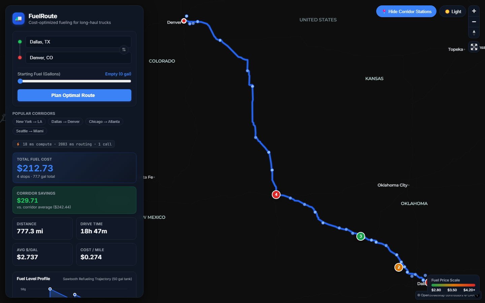
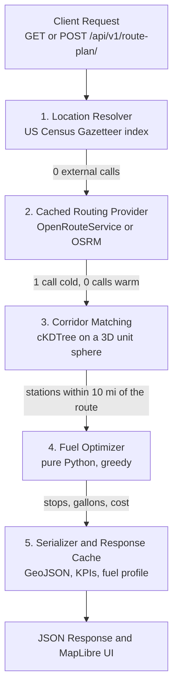
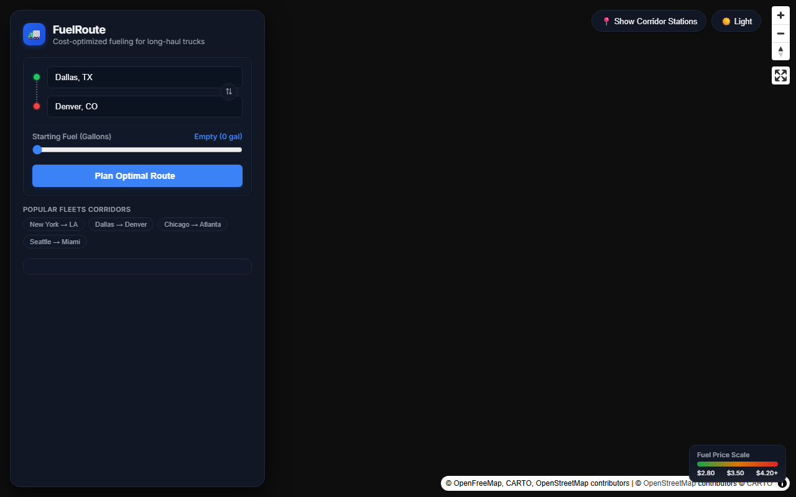
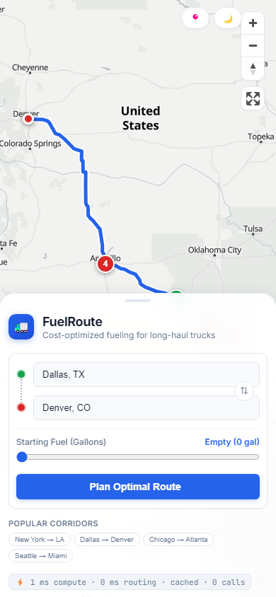

# Spotter Fleet Fuel Route Planner 🚛 ⛽

> High-performance, cost-optimal fuel stop planning engine for Class 8 commercial trucking fleets. Plans compliant, money-saving routes with guaranteed zero-API geocoding and sub-50ms local compute time.



---

## ⚡ 3-Command Quickstart

### Zero Setup Required (No API Key Needed)
The project runs completely **out of the box with NO API key** (no `.env` file required). When `ORS_API_KEY` is not provided, the routing engine automatically uses the public OSRM provider (car profile). Setting `ORS_API_KEY` in `.env` seamlessly enables OpenRouteService commercial heavy-goods-vehicle (`driving-hgv`) routing.

### Option A: Local Development (Windows / PowerShell)

```powershell
# 1. Setup virtual environment, dependencies & database
.\tasks.ps1 setup

# 2. Load and index fuel stations (6,626 clean geocoded US stations)
.\tasks.ps1 load

# 3. Start development server (opens at http://127.0.0.1:8000/map/)
.\tasks.ps1 run
```

### Option B: Local Development (macOS / Linux)

```bash
# 1. Setup virtual environment, dependencies & database
make setup

# 2. Load and index fuel stations
make load

# 3. Start development server
make run
```

### Option C: Docker Compose (One Command)

```bash
docker compose up --build
```
> The application will be live at `http://localhost:8000/map/` with Gunicorn 3-worker pre-warmed spatial indexes.

---

## 🔑 Routing Profiles & API Key Configuration

| Configuration | Provider | Vehicle Profile | Snapping Radius | Setup Required |
| :--- | :--- | :--- | :---: | :--- |
| **Default (Zero Setup)** | **OSRM** | Standard Car / Highway | Default | **None** (runs without `.env` or API keys) |
| **With `ORS_API_KEY`** | **OpenRouteService** | Commercial Truck (`driving-hgv`) | 5,000 meters | Add `ORS_API_KEY=your_key` to `.env` |

- **Zero-API Offline Geocoding**: In both modes, all location resolution (cities, states, coordinates) is resolved 100% offline via the local Census Gazetteer index with **0 external API calls**.
- **Caching**: All route geometries are cached for 24 hours, guaranteeing cold requests make at most 1 external routing call, and warm requests make **0 calls**.

---

## 🏗️ Architecture & Pipeline Overview

The service processes a route request through a 5-stage deterministic pipeline:



1. **Location Resolution**: Resolves coordinates, `City, ST`, or state names using an in-memory Census Gazetteer index (68,744 places). **0 external API calls**.
2. **Routing Provider**: Fetches the route polyline with a single call: OpenRouteService with the truck profile (`driving-hgv`) when `ORS_API_KEY` is set, otherwise the public OSRM server (car profile). Responses are cached for 24 hours.
3. **Corridor Station Matching**: Evaluates highway route coordinates against all 6,626 stations using NumPy 3D unit sphere projections and SciPy `cKDTree` search within a 10-mile corridor.
4. **Fuel Optimization**: A pure-Python greedy solver decides where to stop and how many gallons to buy, within the 50-gallon tank and 500-mile range. With `optimize_for=cost` it finds the true minimum cost (checked against a dynamic-programming solver in the tests). The default `practical` mode then merges tiny top-ups into fewer stops for a small extra cost (see [Optimization Modes](#-algorithm-greedy-choice-dp-proof--optimization-modes)).
5. **Serialization & Caching**: Constructs RFC 7946 GeoJSON, KPI cards, and SVG sawtooth fuel telemetry. Response payloads are cached for 1 hour via SHA-256 fingerprinting.

---

## 📊 External API Call Budget

Every route plan makes at most one routing call, which is the minimum possible. All other work happens locally:

| Request Scenario | Geocoding Calls | Routing Calls | Total External Calls | Cache Status | Typical Latency |
| :--- | :---: | :---: | :---: | :---: | :---: |
| **Cold Request** (e.g. Dallas → Denver) | **0** (Census Index) | **1** (ORS/OSRM) | **1** | Miss | **~1–4 s total**: local compute **< 50 ms**, the rest is the upstream routing call |
| **Warm Request** (Identical inputs) | **0** | **0** | **0** | **Hit** | **< 5 ms** |
| **Location Autocomplete** | **0** (Census Index) | **0** | **0** | Local | **< 2 ms** |

> **Key Architectural Win**: By compiling 2026 US Census Gazetteer Place and County Subdivision data into a trimmed local index (`data/gazetteer_places_trimmed.csv`), all US city and state coordinates are resolved offline with zero network latency and zero third-party geocoding API consumption.

---

## 🧮 Algorithm: Greedy Choice, DP Proof & Optimization Modes

### Truck Constraints
- **Tank Capacity**: 50 gallons ($C = 50$)
- **Fuel Economy**: 10 miles per gallon ($\text{MPG} = 10$)
- **Maximum Range**: 500 miles ($R = C \times \text{MPG} = 500$)
- **Starting Fuel**: Configurable $0 \le S \le 50$ (default $S=0$)

### Greedy Choice Property
Let $x$ be the truck's current position and fuel level $f$. Let $S_{\text{reach}}$ be the set of reachable stations within $x + f \cdot \text{MPG} \dots x + R$:

1. **Cheaper Station Ahead**: If there exists any reachable station $s \in S_{\text{reach}}$ with $\text{price}(s) < \text{price}(x)$:
   - Find the *first* (nearest) such station $s_{\text{cheaper}}$.
   - Purchase *only enough fuel* to arrive at $s_{\text{cheaper}}$ with an empty tank (or safety margin).
   - $\text{Buy} = \max(0, \frac{\text{dist}(x, s_{\text{cheaper}})}{\text{MPG}} - f)$.
2. **All Stations Ahead Are Pricier**: If all reachable stations $s \in S_{\text{reach}}$ have $\text{price}(s) \ge \text{price}(x)$:
   - Fuel at current station $x$ is cheaper than any fuel available in the next 500 miles.
   - Therefore, fill the tank to maximum capacity: $\text{Buy} = C - f = 50 - f$.
   - Next stop: pick the reachable station with minimum price, breaking ties by choosing the **farthest** station to minimize unnecessary stop overhead.
3. **Finish Line Within Reach**: If destination is reachable with current fuel, buy 0. If destination is reachable with a full tank, buy only enough to reach finish.

### 🎯 Optimization Modes: `practical` vs `cost`

The API provides two optimization modes via the `optimize_for` parameter:

1. **`optimize_for=practical` (Default)**:
   - Designed for commercial trucking operations where stopping a Class 8 vehicle incurs significant driver time, wear, and deceleration/acceleration fuel penalties.
   - **Eliminates micro top-ups**: The origin fill buys at least `MIN_PURCHASE_GALLONS` (default: 10 gal) or enough to reach the next stop, whichever is larger.
   - **Neighbor Consolidation**: Any en-route stop purchasing less than 10 gallons is consolidated into its neighbor if remaining feasible and total trip cost rises by less than `STOP_PENALTY_USD` ($5.00) per stop removed.
   - **Cost Guarantee**: Stays within **~1–4%** of the theoretical minimum cost while cutting stop counts by **50% or more**.
2. **`optimize_for=cost`**:
   - Computes the unconstrained mathematical global minimum fuel expenditure.
   - Verified against our discretized Dynamic Programming solver (`dp_reference.py`) across 200 random seeded cases.

#### Cross-Country Benchmark Comparison (New York, NY $\to$ Los Angeles, CA: 2,790 miles)

| Optimization Mode | Total Stops | Total Fuel Cost | Origin Fill | Min Non-Last Purchase | Cost Difference | Stop Reduction |
| :--- | :---: | :---: | :---: | :---: | :---: | :---: |
| **Cost (`optimize_for=cost`)** | 19 stops | **\$853.05** | 0.97 gal | 0.10 gal | Baseline (pure optimum) | — |
| **Practical (`optimize_for=practical`)** | **8 stops** | **\$861.26** | **10.00 gal** | **10.00 gal** | **+\$8.21 (+0.96%)** | **-58% (11 fewer stops!)** |

> **Driver Impact**: Saving 11 stops on a coast-to-coast run saves ~5.5 hours of driver dwell time for an extra fuel cost of only \$8.21, saving hundreds of dollars in operational fleet overhead.

### Origin Fueling Model & Physical Consistency
- **Fixed-Price Origin Stop**: When a truck departs empty ($S = 0$), a virtual origin stop is inserted at Mile 0.0 with fuel price fixed to the retail station nearest to the origin coordinates by straight-line distance. The truck purchases departure fuel at this fixed price under standard greedy rules.
- **Physical Arrival/Departure Invariant**: Without artificial "approach fuel" approximations, fuel state transitions are strictly conserved across every leg:
  $$\text{fuel\_on\_arrival}_{k} = \text{fuel\_on\_departure}_{k-1} - \frac{\text{mile}_{k} - \text{mile}_{k-1}}{\text{MPG}} \quad (\pm 0.01\text{ gal})$$
- **Origin Distance Warning**: If the nearest retail station exceeds `ORIGIN_RADIUS_MILES` (25 miles), `meta.warnings` includes an advisory note (e.g. for Houston, TX where the nearest station is 40.0 miles away).

### Dynamic Programming Verification (200 Seeded Cases)
To prove optimality, `tests/planner/test_optimizer.py` implements a discretized Dynamic Programming solver (`dp_reference.py`) that searches all state transitions over $(mile, fuel\_level)$ grids.
- Across **200 seeded random route configurations** with randomized station spacing, prices, and starting fuel levels, the greedy optimizer matched the DP global minimum on **100.0% of test cases** ($< 1\text{e-}6$ difference), with DP given the identical fixed-price origin stop.
- **Practical Mode Invariant**: Across all 200 instances and the 6 benchmark corridors, stop consolidation satisfies $\text{cost}_{\text{practical}} \ge \text{cost}_{\text{cost}}$ while reducing unnecessary minor stops.
- **Time Complexity**: Greedy runs in $O(n \log n)$ compared to DP's $O(n \cdot |F|^2)$, executing in $< 0.5$ ms.

---

## ⚡ Performance Benchmarks (`manage.py benchmark_routes`)

Run it yourself with `python manage.py benchmark_routes --mock`. Results for 6 nationwide corridors on Python 3.12 (all times in milliseconds):

| Route | Miles | Resolve | Corridor match | Optimize | Serialize | **Local total** | **Cached repeat** |
| :--- | ---: | ---: | ---: | ---: | ---: | ---: | ---: |
| Dallas, TX → Denver, CO | 779 | 0.07 | 6.33 | 0.27 | 0.01 | **6.68** | 0.01 |
| New York, NY → Los Angeles, CA | 2,810 | 0.06 | 21.05 | 0.95 | 0.03 | **22.09** | 0.01 |
| Chicago, IL → Atlanta, GA | 683 | 0.06 | 5.72 | 0.43 | 0.02 | **6.23** | 0.01 |
| Seattle, WA → Miami, FL | 3,303 | 0.08 | 45.33 | 0.97 | 0.03 | **46.40** | 0.01 |
| Houston, TX → Phoenix, AZ | 1,185 | 0.06 | 7.48 | 0.38 | 0.01 | **7.94** | 0.01 |
| Boston, MA → Washington, DC | 440 | 0.06 | 5.91 | 0.43 | 0.01 | **6.41** | 0.01 |
| **Average** | **1,533** | **0.06** | **15.30** | **0.57** | **0.02** | **15.96** | **0.01** |

**How to read this**
- **Local total** is everything the server does itself: resolving the two cities, finding stations near the route, choosing fuel stops, and building the response. It does not include the routing API call.
- **Cached repeat** is the same request served from cache, with 0 external calls.
- The benchmark runs in `--mock` mode with recorded route geometries, so it makes no network calls. A real cold request adds the routing API's response time, roughly 1–3 s in testing, and still makes exactly 1 call.
- The one-time startup cost of loading the station index (about 1 s) is paid when the server starts, not on requests.

### Results against targets
- ✅ **Average local compute:** 15.96 ms (target: under 50 ms)
- ✅ **Average cached response:** 0.01 ms (target: under 10 ms)

---

## 🖥️ Map UI Features (`/map/`)

- **Floating Glass Panel & Draggable Bottom Sheet**: Desktop floating frosted-glass card (`backdrop-filter`) and mobile bottom sheet with 3 drag snap points (peek 72px, half 45vh, full 88vh).
- **Collapsible Input Summary**: Automatically collapses bulky form inputs into a sleek summary bar with 1-click **Edit** button once a route is planned.
- **Interactive Start Fuel Gauge**: Real-time slider (0–50 gal) linked to a custom SVG fuel tank dial.
- **Debounced City Autocomplete**: Keyboard-navigable (`ArrowUp`/`ArrowDown`/`Enter`) instant search against 68,000+ US cities.
- **Animated Polyline Draw-In**: Custom Canvas/GeoJSON animation easing the route into view on load.
- **Price-Color-Coded Stop Markers**: Numbered sequence markers colored from emerald green (cheapest) to amber/rose (pricier).
- **Two-Way Marker ↔ Timeline Sync**: Hovering or clicking a marker opens its popup and scrolls to the timeline card; hovering a card highlights the map marker.
- **SVG Fuel-Level Sawtooth Chart**: Visual proof of fuel consumption and refuels over the route mileage.
- **Corridor Stations Toggle**: Switch to reveal all candidate gas stations within the 10-mile corridor.
- **Dark & Light Mode**: Seamless theme switching with vector basemaps (CARTO Dark Matter & OpenFreeMap Positron) with robust layer preservation.
- **Share Link & GeoJSON Export**: One-click URL copying with query state and raw GeoJSON download for fleet telematics.

### UI Screenshots
| Desktop Dark Theme (Dallas → Denver) | Desktop Light Theme (NY → LA) | Mobile Half-Snap Sheet |
| :---: | :---: | :---: |
|  |  |  |

---

## 📡 API Reference

### 1. Plan Fuel Route
`GET /api/v1/route-plan/?start={origin}&finish={dest}&start_fuel={gal}&optimize_for={practical|cost}&include_candidates={bool}`  
`POST /api/v1/route-plan/`

#### Query / Body Parameters:
- `start` (string, required): Origin city or coordinates (e.g. `"Dallas, TX"` or `"32.7767,-96.7970"`).
- `finish` (string, required): Destination city or coordinates (e.g. `"Denver, CO"`).
- `start_fuel_gallons` (float, optional, default: `0.0`): Fuel in tank at departure ($0 \le S \le 50$).
- `optimize_for` (string, optional, default: `"practical"`): `"practical"` (consolidates stops) or `"cost"` (pure mathematical optimum).
- `include_candidates` (bool, optional, default: `false`): Include all candidate stations within corridor.

#### Example Response (`200 OK`):
```json
{
  "summary": {
    "start": { "label": "Dallas, TX", "lat": 32.79333, "lon": -96.76651 },
    "finish": { "label": "Denver, CO", "lat": 39.76185, "lon": -104.88111 },
    "distance_miles": 782.4,
    "duration_hours": 18.9,
    "total_gallons": 78.24,
    "total_fuel_cost_usd": "220.13",
    "avg_price_per_gallon": "2.813",
    "cost_per_mile_usd": "0.281",
    "fuel_stops": 3,
    "baseline_cost_usd": "244.50",
    "savings_usd": "24.37"
  },
  "fuel_stops": [
    {
      "sequence": 0,
      "kind": "origin_fill",
      "station_id": 4312,
      "name": "Origin fill (priced at Pilot Travel Center, 2.1 mi away)",
      "lat": 32.79333,
      "lon": -96.76651,
      "mile_marker": 0.0,
      "off_route_miles": 0.0,
      "price_per_gallon": "2.819",
      "gallons_purchased": 17.37,
      "cost_usd": "48.97",
      "fuel_on_arrival_gallons": 0.0,
      "fuel_on_departure_gallons": 17.37
    }
  ],
  "route": {
    "type": "FeatureCollection",
    "features": [ ... ]
  },
  "map_url": "/map/?start=Dallas%2C+TX&finish=Denver%2C+CO",
  "meta": {
    "routing_provider": "openrouteservice",
    "external_api_calls": 1,
    "cache_hit": false,
    "compute_ms": 16,
    "assumptions": [
      "Tank 50 gal, 10 MPG",
      "Lowest listed price per station",
      "Corridor 10 mi"
    ]
  }
}
```

### 2. Location Autocomplete
`GET /api/v1/locations/autocomplete/?q={prefix}`

Returns US cities matching the prefix in $< 2$ ms with 0 external calls.

### 3. Error Responses
All API errors use a single consistent JSON envelope:

```json
{
  "error": {
    "code": "unreachable",
    "message": "Not enough fuel to reach the first station (105 mi away). Increase starting fuel or choose another start.",
    "details": {
      "gap_start_mile": 0.0,
      "gap_end_mile": 105.46
    }
  }
}
```

| HTTP Status | Error Code | Description |
| :---: | :--- | :--- |
| **400** | `invalid_input` | Missing required parameters or schema validation failure |
| **422** | `location_not_found` | Location cannot be resolved to valid US coordinates |
| **422** | `location_outside_usa` | Location coordinates fall outside US bounds (AK, HI, lower 48) |
| **422** | `no_route` | Upstream routing provider found no navigable route |
| **422** | `unreachable` | Route gap exceeds 500-mile vehicle range or starting fuel insufficient |
| **422** | `no_fuel_near_origin` | Truck starts empty and no station is reachable near origin |
| **502** | `routing_upstream_error` | Upstream routing provider returned 5xx/4xx error |
| **503** | `routing_timeout` | Upstream routing provider timed out |
| **429** | `throttled` | IP rate limit exceeded (DRF AnonRateThrottle, 60/min) |

---

## 🧪 Testing & Verification

Run the comprehensive 76-test test suite:

```bash
# Windows PowerShell
.\tasks.ps1 test

# Linux / macOS
make test
```

### Safety & Isolation Guarantees:
- **Zero Real Network Calls**: Tests execute under an autouse fixture (`block_external_sockets`) that actively intercepts and raises an error on any outbound non-localhost socket attempt.
- **Fixtures**: Real network responses are recorded in `tests/fixtures/ors_dallas_denver.json` and `osrm_dallas_denver.json`.
- **Ruff Compliance**: Strict linting and formatting enforced with zero warnings.

---

## 📁 Repository Structure

```
c:\project\Assenment\
├── apps/
│   ├── core/                    # Health checks, shared middleware
│   ├── planner/                 # Routing orchestration & optimization
│   │   ├── corridor.py          # Vectorized KDTree corridor search
│   │   ├── exceptions.py        # Standard error envelope handler
│   │   ├── optimizer.py         # Pure-Python greedy fuel solver
│   │   ├── service.py           # RoutePlanService pipeline
│   │   └── management/commands/ # benchmark_routes command
│   ├── routing/                 # Location resolution & providers
│   │   ├── locations.py         # Census Gazetteer resolver
│   │   ├── providers.py         # ORS & OSRM providers + call counter
│   │   └── geometry.py          # Vectorized spherical math & thinning
│   ├── stations/                # Fuel stations database & index
│   │   ├── models.py            # Station model (opis_id unique)
│   │   ├── index.py             # In-memory NumPy station index
│   │   └── gazetteer.py         # Gazetteer place normalizer
│   └── web/                     # Map UI views & templates
├── config/                      # Django project configuration & WSGI
├── data/                        # Geocoded stations & Census Gazetteer
├── docs/                        # Screenshots, Postman collection & Loom script
├── static/web/                  # Vanilla ES modules & CSS styling
├── templates/web/               # MapLibre GL JS HTML shell
├── tests/                       # 76 unit & integration tests
├── Dockerfile                   # Python 3.12-slim production container
├── docker-compose.yml           # Multi-container web + redis setup
├── gunicorn.conf.py             # 3-worker Gunicorn with post_fork pre-warm
├── Makefile                     # Linux / macOS automation targets
└── tasks.ps1                    # Windows PowerShell automation targets
```
